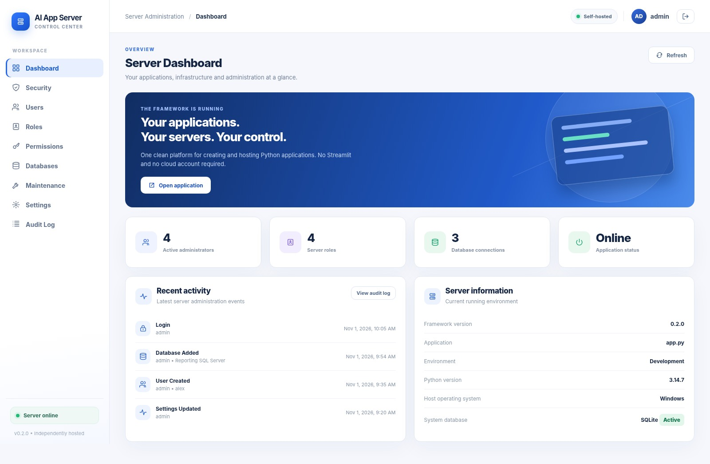

# AI App Server v1.0.5

**A modular, self-hosted Python application framework** for building browser-based applications, with optional Ollama integration, single- or multi-agent workflows, an administration dashboard, individual users, SQLite storage, and isolated application instances.



**Version:** `1.0.5` &nbsp;|&nbsp; **Licence:** MIT &nbsp;|&nbsp; **Python:** 3.11+

> **Two Windows BAT files only:** `INSTALL.bat` to install, and `START.bat` to launch/manage a local installation. There are no separate update, background, service or shortcut BAT files.

## 1. Download the complete project

Open **[AI-App-Server on GitHub](https://github.com/tuckbloor/AI-App-Server)**, select **Code → Download ZIP**, and extract the ZIP to any location. For example, you can extract the *source* to your Downloads folder or to `E:\AI-App-Server`.

The complete source contains `engine/`, `starter/`, `tools/`, `tests/`, `docs/`, `production/`, `INSTALL.bat`, `START.bat`, and `README.md`. **Extract the complete ZIP; do not download only the BAT files.**

This source folder is **not necessarily** your final installation directory. The installer asks you where the working server should be installed.

## 2. Install on Windows (choose any drive)

### Requirements

- Windows 10 or Windows 11.
- Python 3.11 or later, accessible using the Windows `py` launcher or `python` on PATH. Check using `py -3 --version` in PowerShell. Install Python from [python.org](https://www.python.org/downloads/windows/) if necessary.
- An internet connection for the initial Python package installation.
- A destination folder where you have write permission. Administrator permission is **not** needed for an ordinary user-folder installation.

### Steps

1. In the **extracted source folder**, double-click **`INSTALL.bat`**.
2. The installer shows a window where you can type or browse to the installation directory.
3. Use the suggested location, or select another **empty** folder on `C:`, `D:`, `E:` or any available drive.
4. Click **Install**. The installer copies the bundled framework, creates a private `.venv`, installs Python dependencies, creates the starter application and starts the server.
5. On successful installation, keep the **installed** folder location: this is where `START.bat` lives.

**Default suggested installation path:**

```text
%LOCALAPPDATA%\Programs\AI-App-Server
```

For example, for a Windows account named `Chris`, this may expand to `C:\Users\Chris\AppData\Local\Programs\AI-App-Server`. The actual location depends on your Windows account and the directory you choose. You can paste `%LOCALAPPDATA%\Programs\AI-App-Server` into the Windows File Explorer address bar to find the default folder.

**Existing installations are protected:** `INSTALL.bat` will **not** overwrite a non-empty destination. To keep an existing database, **do not uninstall or delete its folder**. The installer is for new installations and is **not** an in-place upgrade tool.

## 3. Start your server

Open your **installed** AI App Server folder and double-click **`START.bat`**. It starts the local server in the background and normally opens your web browser. You do not need to leave a command window running.

| Address | Purpose |
|---|---|
| `http://127.0.0.1:8501/` | Application home page (usual first-install port) |
| `http://127.0.0.1:8501/admin` | Administration panel |
| `http://127.0.0.1:8501/health` | Server health check |

If port 8501 is occupied during **first** installation, the launcher picks an available port. Look at its startup output or the saved `config/hosting.json` inside the installed folder for the actual port. A configured installation does **not** silently switch ports later.

**First administrator login:** the bundled starter installation initially uses username `admin` and password `password` and requires a password change. Change it immediately, configure recovery information, and **never expose a server using the initial credentials to a network or the internet**. You can also complete initial setup from the trusted local terminal with the `setup-admin` command described below.

## 4. Create a desktop shortcut

To create a shortcut that **starts the server**:

1. Press **Win + E** to open File Explorer.
2. Browse to the **installed** folder (the default is `%LOCALAPPDATA%\Programs\AI-App-Server`).
3. Right-click **`START.bat`**. On Windows 11, select **Show more options** if needed.
4. Select **Send to → Desktop (create shortcut)**. Rename it **AI App Server**.
5. Double-click that desktop shortcut whenever you want to launch the server.

To create a shortcut that **only opens the web page** (it does not start a stopped server), right-click the desktop, choose **New → Shortcut**, enter `http://127.0.0.1:8501/` (or your saved port), and name it **AI App Server Dashboard**.

## 5. Start automatically when you sign in to Windows

A successful normal installation starts the server immediately and adds a **per-user Windows Startup entry**. It will then start in the background **after you sign in to Windows**. This uses the existing `START.bat` and a small Windows Startup entry; it does **not** install a Windows Service.

To inspect the entry, press **Win + R**, type `shell:startup` and press **Enter**. Look for an entry beginning **AI App Server**. The launcher creates this entry automatically during installation; you do not need to copy an extra BAT file there.

To stop the running server, check status, or disable sign-in startup, open PowerShell **in the installed folder** and run:

```powershell
.\START.bat --status
.\START.bat --stop
.\START.bat --disable-autostart
```

To start it again, double-click `START.bat` or run ` .\START.bat `. To re-enable automatic sign-in startup after disabling it, use the following from the installed folder:

```powershell
& ".\.venv\Scripts\python.exe" -m ai_app_server.desktop_launcher install --project (Get-Location).Path
```

**Difference:** the built-in sign-in startup requires a Windows user to log in. A genuine Windows Service can run before sign-in, but it requires separate administrator setup.

## 6. Optional: run it as a Windows Service (advanced)

**This is optional. Most users should use the automatic Windows sign-in startup above.** Windows Service support uses the optional `pywin32` dependency and Windows Service Control Manager. It requires an **elevated PowerShell window** and an installation whose code and data are accessible to the restricted Windows **LocalService** account.

A per-user installation under `%LOCALAPPDATA%` may **not** be readable by LocalService, and moving an existing installation can break its saved paths. For a new service deployment, choose a suitable dedicated directory such as `C:\AI-App-Server` **during installation**, then test the service account's access. Do not move or overwrite a live installation to convert it into a service.

The following commands use `C:\AI-App-Server` as an **example only**; replace it with the actual path. Open **PowerShell as Administrator**:

```powershell
Set-Location 'C:\AI-App-Server'

# Prevent the normal sign-in startup from competing for the same port.
.\START.bat --disable-autostart
.\START.bat --stop

# Install the optional Windows Service dependency in this server's venv.
& '.\.venv\Scripts\python.exe' -m pip install -e '.\engine[windows-service]'

# Install and start this instance as an automatic Windows Service.
& '.\.venv\Scripts\python.exe' -m ai_app_server.cli service install '.\app\app.py' --data-dir '.\data'

# Check service status.
& '.\.venv\Scripts\python.exe' -m ai_app_server.cli service status '.\app\app.py' --data-dir '.\data'
```

The service runs with the Windows **LocalService** identity, is configured for automatic startup, and serves the application on the configured loopback port. The installer attempts to grant LocalService access to the installation's `data/` directory. **It does not guarantee access to the Python environment and application source:** verify filesystem permissions and test service start/restart on the actual Windows computer before relying on it. Stop sign-in startup first to avoid port conflicts.

To manage or remove the service (in **Administrator PowerShell**, from the installed folder):

```powershell
& '.\.venv\Scripts\python.exe' -m ai_app_server.cli service stop '.\app\app.py' --data-dir '.\data'
& '.\.venv\Scripts\python.exe' -m ai_app_server.cli service start '.\app\app.py' --data-dir '.\data'
& '.\.venv\Scripts\python.exe' -m ai_app_server.cli service restart '.\app\app.py' --data-dir '.\data'
& '.\.venv\Scripts\python.exe' -m ai_app_server.cli service uninstall '.\app\app.py' --data-dir '.\data'
```

You can also inspect the installed service with Windows **Services** (`Win + R` → `services.msc`). **Service installation was not end-to-end tested on a Windows host as part of this release; treat it as an advanced option requiring validation.** Never expose a development-mode server directly to the internet. For a production deployment use the separately documented Linux/HTTPS deployment guidance.

## 7. Administration, data and backups

Each installed instance is independent: it has its own `app/`, `data/`, `config/`, administrator, application users, logs and port. These are **user-owned runtime files**, not distributable source code.

| Installed directory | Contents |
|---|---|
| `app/` | Your Python application source |
| `data/` | SQLite database, encryption key, logs and service/runtime state |
| `config/` | Saved hosting settings, including the port |
| `engine/` | Reusable framework source |
| `.venv/` | Isolated Python environment |

**Back up both the database and its secret key**. Losing the key can prevent encrypted data from being recovered. The CLI supports verified snapshots; see [Developer Guide](DEVELOPER-GUIDE.md), [Security Status](SECURITY-STATUS.md), and [Production Checklist](PRODUCTION-CHECKLIST.md). Do not publish `data/`, `config/`, `.venv/`, account credentials or `.env` files on GitHub.

For a new local installation whose admin password has not yet been changed, you can set it using a terminal in the installed folder:

```powershell
& '.\.venv\Scripts\python.exe' -m ai_app_server.cli setup-admin '.\app\app.py' --data-dir '.\data'
```

This command prompts for an email and a new password; it does not silently reset an already configured administrator.

**Updates:** Do **not** run the fresh installer over a working installation. Preserve and back up the complete `app/`, `data/`, `config/` and customizations; use only an explicitly tested upgrade procedure suitable for that installed version.

## 8. Using AI App Server to build applications

The reusable Python package lives in `engine/`. Developers write their own application logic in Python. Ollama, tools, and agent workflows are optional; they belong to the individual application, **not** to a global administrative agent.

- [Developer Guide](DEVELOPER-GUIDE.md) — build an app, UI elements, development workflow.
- [MCP Module](MCP-MODULE.md) — optional MCP configuration and permissions.
- [Release Notes](RELEASE-NOTES.md) — what changed in this version.

For Linux or Docker, see [production instructions](production/README.md). The Windows `.bat` launcher is for local development and is not a substitute for audited production hosting.

## 9. Test from the complete source directory

```powershell
py -3 -m pip install -e '.\engine[dev]'
py -3 -m pytest -q
```

The repository also contains GitHub Actions tests for Windows and Linux, including a non-destructive Windows fresh-install check. **Passing these does not replace a full clean-PC installation and Windows Service acceptance test.**

## 10. Troubleshooting

**`START.bat` says the server is not installed** — You may be in the **source** folder instead of the **installed** folder. Open the destination selected during installation; it must contain `.venv\Scripts\python.exe` and `START.bat`.

**Python not found** — Install Python 3.11+ and make sure `py -3 --version` works, then rerun `INSTALL.bat`.

**Browser does not open** — Run `.\START.bat --status`, inspect `config\hosting.json` for the actual port, and open `http://127.0.0.1:<port>/` manually.

**Port occupied after installation** — Another process is already using the saved port. Stop that process or change the port in **Admin → Service**. Existing installations deliberately do not silently change ports.

**Server fails to start** — Inspect `data\logs\server.log` in the installed folder. Do not delete `data/` to fix a startup error.

**Installation refuses an existing folder** — This is deliberate data protection. Choose an empty directory; the fresh installer does not upgrade existing installations.

**Windows Service fails to start** — Inspect Windows Event Viewer, the Services console, the selected installation's permissions, and the configured service identity. Service deployment requires a separate acceptance test.

## Licence and security

Released under the [MIT licence](LICENSE). This project is intended for trusted, developer-reviewed Python applications. Python and MCP tools are **not** isolated from the application's local data: it is **not** a sandbox for arbitrary untrusted code. Review [Security Status](SECURITY-STATUS.md) before deployment.
